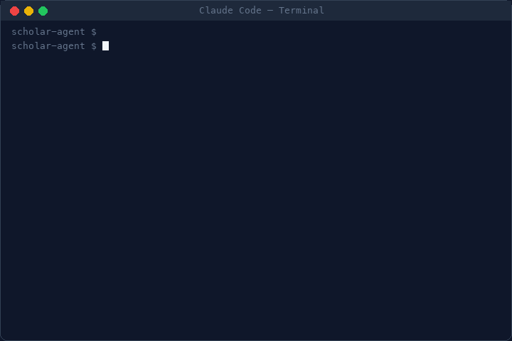
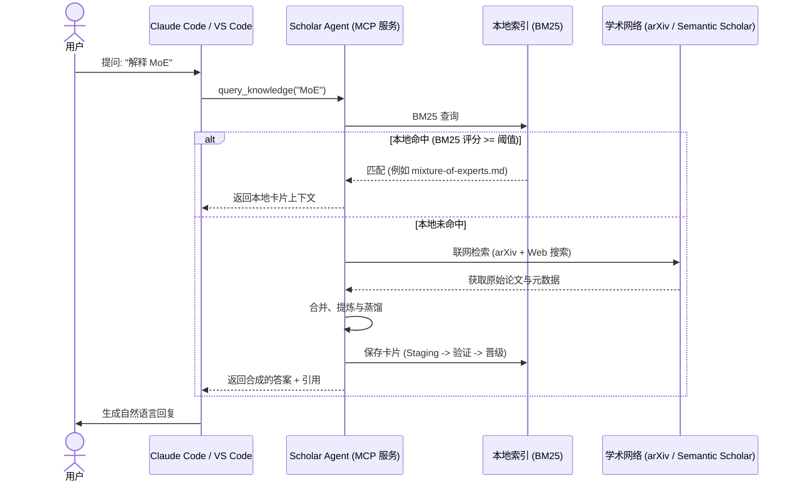

<p align="center">
  
</p>

<p align="center">
  
  
  
  
  
</p>

<p align="center">
  <a href="https://mindpulse.top">
    
  </a>
</p>

<p align="center">
  <a href="README.md">English</a> | <a href="README.zh-CN.md">简体中文</a>
</p>

<p align="center">
  <strong>在您的专业领域不断进化的 AI —— 每一个问题都在积累。</strong>
</p>

---

## MindPulse 学术套件 (MindPulse Academic Suite)

Scholar Agent 是 **MindPulse 学术套件** 的一部分，形成了本地开源工具与云端全托管服务之间的强大协同：

* 🌌 **Scholar Agent** (开源 & 本地): 一个本地优先的知识飞轮，通过 MCP (Model Context Protocol) 与您的 IDE 深度集成。它将研究成果保存为本地 Markdown 知识卡片，逐步构建您的专属个人 LLM-Wiki。
* ⚡ **[PaperPulse](https://mindpulse.top)** (云端 SaaS): 一个全托管的每日学术简报 SaaS，监控 arXiv/Semantic Scholar，基于您的个性化科研偏好对论文进行自动打分，并将提炼出的文献精读直接推送到您的微信或邮箱。

| 功能特性 | Scholar Agent (本地) | PaperPulse (云端 SaaS) |
| :--- | :--- | :--- |
| **部署与模式** | 本地 MCP 服务 (开源) | 全托管 SaaS 服务 (闭源) |
| **核心工作流** | 按需检索、研究与知识库沉淀 | 每日自动爬取、偏好评分与邮件/微信推送 |
| **数据存储** | 本地 Markdown 文件 / 向量数据库 | 云端 Postgres / 托管索引 |
| **IDE 集成** | 深度集成于 Claude Code, VS Code, Cursor | 网页端仪表盘与微信机器人 |
| **资费情况** | 免费且开源 | 免费体验 / 增值订阅 |

💡 **协同联动（一键本地同步）**：
* **一键同步**：当您在本地启动 Scholar Agent MCP 服务后，在 PaperPulse 网页端只需点击 **“导入本地 Scholar Agent”** 按钮，笔记即可通过本地安全回环接口（Loopback）免下载、免沙箱限制直接一键同步写入您的本地 `knowledge/` 知识库目录并自动索引，实现云端精读与本地知识大脑的无缝链接！
* **手动导出**：您也可以点击 **“导出 Markdown”** 按钮下载标准 Markdown 格式笔记，手动放入本地知识库目录。

### 知识图谱同步 (Knowledge Graph Sync)

除了笔记导入，Scholar Agent 还能与 PaperPulse 双向同步知识图谱本身：

* **本地 → 云端**：当 `scholar-agent serve-http` 运行时，PaperPulse 图谱页面会通过浏览器读取回环端点 `GET http://127.0.0.1:8374/graph`，把您的本地笔记合并进云端图谱视图。
* **云端 → 本地**：`scholar-agent graph sync` 将 PaperPulse 的论文关系边拉取到本地论文库（可用 `--max-nodes` / `--min-confidence` 调节），后续导出即包含这些边。
* **CLI**：`scholar-agent graph` 生成可交互的 HTML 图谱；`scholar-agent graph --json [PATH]` 导出机器可读的 JSON 契约（省略 PATH 时输出到 stdout）。

`GET /graph` 返回 schema_version 1 契约：

```json
{"schema_version": 1,
 "nodes": [{"id", "title", "node_type", "topic", "domain", "tags", "year", "arxiv_id", "venue", "domains", "is_local"}],
 "edges": [{"source", "target", "rel_type", "confidence", "origin"}],
 "stats": {"local_nodes": N, "local_edges": M, "cloud_edges": K}}
```

* `node_type` 取值为 `knowledge-card` / `paper-note` / `daily-note` / `other`；`arxiv_id` 是本地论文笔记与云端论文之间的桥接键。
* 边的 `rel_type`：本地 wiki 链接为 `references`（`origin: "local"`）；云端同步的关系为 `cites` / `extends` / `improves_upon` / `baseline_for` / `variant_of`（`origin: "paperpulse"`）。
* `GET /graph?local_only=1` 跳过云端边，仅返回本地图谱。

认证与导入端点一致：当 `.scholar.json` 配置了 `paperpulse_token` 时，请求必须携带 `Authorization: Bearer <token>`；否则仅接受回环来源/对端的请求。该 token 是 PaperPulse 的短期登录 JWT，没有刷新流程——过期后请重新登录 PaperPulse，并更新 `.scholar.json` 中的 `paperpulse_token`。

---

## 为什么需要 Scholar Agent

每次与 AI 对话都在产生知识——研究结论、技术解答、文献引用。但大模型是无状态的，下一次对话从零开始。昨天 AI 为你完成的研究，今天无法复用。

Scholar Agent 让 AI 知识持久化。它将对话中的研究和答案保存为本地知识卡片——结构化、可引用、相互链接。AI 在回答前优先查询已有的本地知识，在已有积累的基础上不断丰富。

最终形成的是一个属于你的 **LLM-Wiki**：结构化、可溯源、持续增长——让 AI 在你关注的领域越来越准确。

---

<p align="center">
  
</p>

<p align="center"><sub>提问 → 研究 → 沉淀为知识卡片 → 知识持续积累</sub></p>

---

## 做了什么

### 架构与数据流

当您提出问题时，Agent 会在回退到外部源之前，通过本地优先的检索循环来路由查询：



### 知识持久化

每次对话都可以产生一张知识卡片——结构化记录包含：

- 提出的问题
- 带引用来源的证据支撑答案
- 置信度评分与不确定性标记
- 可追溯的来源引用

这些卡片累积为可搜索的本地知识库。下次遇到类似问题，AI 直接从已有研究中获取答案。

### 知识网络

卡片不是孤立文件。Scholar Agent：

- 为每张卡片维护**质量生命周期**：`draft → reviewed → trusted → stale → deprecated`
- 自动生成 **`[[wiki-links]]`**，连接相关卡片
- 追踪**来源**——每个论断都能回溯到原始证据
- 输出 **Obsidian 兼容**的 Markdown（YAML frontmatter + wiki-links）
- **Obsidian 知识图谱开箱即用** —— 您可以直接将知识数据目录（例如 `~/scholar/`）作为 Obsidian 库（Vault）打开，从而直接导航和探索可视化的知识图谱。

### 基于证据的答案

研究一个问题时，Scholar Agent：

1. **搜索**本地知识（BM25 关键词索引）
2. **不足时**调用网络和学术 API 补充
3. **合成**答案——每个论断都有引用来源
4. **标记**缺乏证据支撑的论断
5. **返回**结构化结果——含置信度和建议的下一步

### 学术研究管线

针对论文研究，Scholar Agent 提供：

- **论文搜索** — arXiv、DBLP、Semantic Scholar，支持 10+ 顶会过滤
- **智能评分** — 四维排名：相关性、时效性、影响力、质量
- **深度分析** — 20+ 章节结构化笔记，AI 辅助补全
- **图片提取** — 从 arXiv 源包和 PDF 中提取论文图表
- **每日推荐** — 双轨模式：2 篇顶会论文 + 2 篇 arXiv 创新论文
- **论文 → 知识卡片** — 将分析结果反哺知识库

### 复用推荐引擎（作为库调用）

每日推荐引擎是一个自包含、无 MCP 依赖的库 API——本地 MCP 工具、CLI
与外部服务（如 PaperPulse）都调用同一个入口，共享同一份
`.scholar.json` 配置语义，输出质量一致：

```python
from scholar_agent.engine.academic.recommender import generate_recommendations

result = generate_recommendations(
    config=my_scholar_json,   # 完整 .scholar.json 字典；省略则从磁盘加载
    date="2026-07-17",        # 可选；默认今天
)
```

只需 `pip install py-scholar-agent[academic]`——无需 MCP server，
引擎层不依赖 fastmcp。

关键配置键（均位于 `academic` 下）：

- `research_interests.research_domains.<名称>.priority` — 领域相对权重
  （默认 1.0）。最高优先级领域按满分计，低优先级领域的 fit 得分按
  比例折减。
- `unified_pipeline.reject_dedup_days` — 被 LLM 评审淘汰的候选在该天数
  内不再进入候选池（默认 14 天），过期后重新获得资格。
- `unified_pipeline.max_daily_recommendations` / `max_candidates` /
  `arxiv_days` — 管线形态参数。

返回字典带版本号（`schema_version: 1`），可直接 JSON 序列化：

```
{schema_version, date, papers: [{arxiv_id, title, abstract, authors, url,
  published_date, categories, scores: {fit, recommendation, llm_novelty?,
  llm_credibility?}, recommendation_reason, track, domain}],
 stats: {arxiv_fetched, s2_fetched, after_dedup, candidates, llm_calls,
  llm_tokens, duration_seconds}, warnings: [...], skipped, total_found, ...}
```

`warnings` 会显式暴露降级行为（例如未设置 `LLM_API_KEY` 时跳过 LLM
评审、改用启发式排名）。

---

## 快速开始

### 安装

```bash
pip install py-scholar-agent
```

或使用 pipx（隔离环境）：

```bash
pipx install py-scholar-agent
```

或从源码安装：

```bash
git clone https://github.com/zfy465914233/scholar-agent.git
cd scholar-agent
pip install -e .
```

### 初始化

```bash
scholar-agent init
```

一条命令创建 Scholar home、知识数据目录、写入配置、注册 MCP 到 Claude Code。用 `scholar-agent init --host all` 可以一次注册 Claude Code、VS Code Copilot 和 OpenCode。初始化后建议运行 `scholar-agent doctor --format text` 确认环境。

### 模式

| 模式 | 命令 | 知识数据目录 | 配置/索引目录 | 作用域 |
|------|------|-------------|-------------|--------|
| **全局**（推荐） | `scholar-agent init` | `~/scholar/` | `~/.scholar/` | 所有项目 |
| **项目级** | `SCHOLAR_HOME=./scholar scholar-agent init` | `my-project/scholar/` | `my-project/scholar/` | 仅当前项目 |
| **Docker** | `docker run -v ~/scholar:/data scholar-agent serve-mcp` | `/data/` | `/data/` | 隔离环境 |

---

## MCP 集成

Scholar Agent 作为 MCP 服务器运行，直接接入你的工具：

- **Claude Code** — `scholar-agent install claude --write`
- **VS Code Copilot** — `scholar-agent install vscode --write`
- **OpenCode** — `scholar-agent install opencode --write`

**内置工具**（始终可用——13 个）。*Toolset* 列是该工具所属的 `SCHOLAR_TOOLSET` 分组：

| 工具 | Toolset | 说明 |
|------|---------|------|
| `query_knowledge` | core | 检索本地知识库；返回命中卡片以及 `knowledge_status` 摘要（`total_cards`、`draft_backlog`） |
| `list_knowledge` | core | 浏览全部知识卡片，可按主题过滤 |
| `save_research` | core | 把结构化、带来源的答案存为知识卡片 |
| `capture_answer` | core | 把一段问答答案存为草稿卡片 |
| `review_card` | core | 按用户的明确指令调整卡片信任状态（`reviewed` / `trusted` / `stale` / `deprecated`） |
| `ingest_source` | core | 把 URL 或原始文本摄取为草稿卡片 |
| `fetch_url` | core | 抓取网页正文为 markdown，并保存本地快照 |
| `build_graph` | paper | 生成交互式知识图谱可视化 |
| `import_paperpulse_note` | paper | 从 PaperPulse SaaS 导入提炼好的论文笔记 |
| `validate_knowledge` | maintenance | 校验卡片 frontmatter、正文密度和来源时效，不写文件 |
| `lint_knowledge` | maintenance | 报告孤儿卡片、断链、陈旧卡片和标题重叠 |
| `scan_stale_knowledge` | maintenance | 报告来源超出领域时效阈值的卡片 |
| `scan_dead_links` | maintenance | 探测卡片来源 URL 的 404 / 410 / 连接失败 |

**学术工具**（设置 `SCHOLAR_ACADEMIC=1` 启用——8 个，均属于 `paper` 分组）：

| 工具 | 说明 |
|------|------|
| `search_papers` | 检索 arXiv + Semantic Scholar 并打分 |
| `search_conf_papers` | 通过 DBLP + Semantic Scholar 增强检索会议论文 |
| `download_paper` | 下载论文 PDF 到本地 |
| `analyze_paper` | 生成结构化的深度分析 markdown 笔记 |
| `extract_paper_images` | 从 arXiv 源码包或 PDF 中提取插图 |
| `paper_to_card` | 把论文分析转换为知识卡片 |
| `daily_recommend` | 运行每日论文推荐流程 |
| `link_paper_keywords` | 为笔记中的关键词自动添加 `[[wikilinks]]` |

`save_research` 启用来源门禁：必须提供非空 `sources` 数组，并让每个 `supporting_claims[].evidence_ids` 引用来源。没有来源的对话沉淀请用 `capture_answer`。URL 摄取和 `fetch_url` 会把一手来源快照存到 `knowledge/_snapshots/`；这些内部快照不会进入卡片索引和治理扫描。

<details>
<summary>Claude Desktop MCP 配置示例</summary>

将以下内容添加到 `claude_desktop_config.json`：
```json
{
  "mcpServers": {
    "scholar-agent": {
      "command": "scholar-agent",
      "args": ["serve-mcp"],
      "env": {
        "SCHOLAR_ACADEMIC": "1"
      }
    }
  }
}
```
</details>

---

## 本地检索

知识通过 **BM25** 建立索引，支持快速关键词搜索——无需外部依赖。可选启用 **embedding** 语义检索层：用 `scholar-agent index --build-embedding-index` 构建一次后，`query_knowledge` 将自动采用混合检索（BM25 + 语义），并在新增卡片时保持索引同步。

---

## CLI 命令参考

| 命令 | 说明 |
|------|------|
| `scholar-agent init` | 一键设置：Scholar home + 知识数据目录 + 配置 + MCP 注册 |
| `scholar-agent serve-mcp` | 启动 MCP 服务器 |
| `scholar-agent doctor --format text --host all` | 查看环境与 MCP 宿主注册诊断信息 |
| `scholar-agent health` | 只读项目健康摘要：配置、索引、陈旧卡片、重复卡片、断链 |
| `scholar-agent config show` | 显示解析后的配置 |
| `scholar-agent index --build-embedding-index` | 构建/重建搜索索引；该标志启用混合检索 |
| `scholar-agent scan-stale --refresh` | 报告陈旧卡片，并可刷新来源快照 |
| `scholar-agent report-dangling` | 报告 notes 和知识卡片中的悬空 `[[wikilinks]]` |
| `scholar-agent report-dead-links` | 诊断知识卡片来源 URL 的死链（404/410/连接失败） |
| `scholar-agent install claude --write` | 注册 MCP 到 Claude Code |
| `scholar-agent install vscode --write` | 注册 MCP 到 VS Code Copilot |
| `scholar-agent install opencode --write` | 注册 MCP 到 OpenCode |

---

## 配置

### 环境变量

| 变量 | 必需 | 说明 |
|------|------|------|
| `SCHOLAR_ACADEMIC` | 否 | 设为 `1` 启用学术工具 |
| `SCHOLAR_TOOLSET` | 否 | 服务端暴露哪些工具。未设置、`default` 或 `all` = 全部；否则是逗号 / 空格 / `+` 分隔的分组列表——`core`（知识读写）、`paper`（图谱、PaperPulse 导入和学术工具）、`maintenance`（只读治理扫描）。未知分组会在启动时报错退出并列出合法取值。 |
| `SCHOLAR_HOME` | 否 | 覆盖 Scholar home。未设置时，配置/索引默认在 `~/.scholar/`，知识数据默认在 `~/scholar/`；设置后，两者都放在 `SCHOLAR_HOME` 下。 |
| `S2_API_KEY` | 否 | Semantic Scholar API key（[免费申请](https://api.semanticscholar.org/)） |
| `LLM_API_KEY` | 否 | LLM API key（用于高级合成管线） |

### 配置文件

完整示例见 [`.scholar.example.json`](.scholar.example.json)。主要配置项：

- `knowledge_dir` — 知识卡片目录路径。默认 `~/scholar/knowledge`；设置 `SCHOLAR_HOME` 后默认为 `$SCHOLAR_HOME/knowledge`。
- `index_path` — BM25 搜索索引路径。默认 `~/.scholar/indexes/local/index.json`；设置 `SCHOLAR_HOME` 后默认为 `$SCHOLAR_HOME/indexes/local/index.json`。
- `academic.research_interests` — 研究领域、关键词和 arXiv 分类
- `academic.scoring` — 论文评分权重

### 默认路径布局

```
~/.scholar/
├── config/         # 配置文件
├── indexes/        # BM25 搜索索引
├── cache/          # 缓存数据
└── outputs/        # 生成输出

~/scholar/
├── knowledge/      # 知识卡片
├── paper-notes/    # 论文分析笔记
└── daily-notes/    # 每日论文推荐
```

设置 `SCHOLAR_HOME` 后，上面两组目录都会创建在该目录下。

---

## 推荐工作流

### 日常研究流

```
提问（通过 MCP）
  → Scholar Agent 先搜索本地知识
  → 本地知识不足时调用网络/学术 API
  → 合成带引用的结构化答案
  → 保存为知识卡片
  → 下次类似问题直接从本地知识库获取答案
```

### 论文分析流

为获得最佳分析质量：

1. **下载**：`download_paper("2510.24701", title="Paper Title", domain="LLM")`
2. **提取图片**：`extract_paper_images("2510.24701")`
3. **深度分析**：`analyze_paper(paper_json)`
4. **沉淀到知识库**：`paper_to_card(paper_json)`

> 在分析前下载 PDF 可以启用全文提取，生成包含具体数据、公式和实验结果的高质量笔记。

---

## 开发

```bash
make dev       # 安装开发依赖 + pre-commit hooks
make lint      # 运行 ruff + mypy
make test      # 运行离线测试（当前收集 1554 个测试；耗时因机器而异）
make coverage  # 运行测试并生成覆盖率报告
make build     # 构建分发包
make check-dist # 构建并验证 sdist/wheel 内容
make docker    # 构建 Docker 镜像
```

详见 [CONTRIBUTING.md](CONTRIBUTING.md)。

## 亮点

- **知识持久化** — 每次对话都可以产生可复用的知识卡片，本地知识库持续增长
- **基于证据** — 每个论断都有引用来源，附置信度评分和不确定性标记
- **质量生命周期** — 卡片被校验、评分、提升，最终标记为过时。完整的来源追踪
- **知识网络** — Wiki-links 连接相关卡片，构建可导航的知识图谱
- **Obsidian 兼容** — 标准 Markdown + YAML frontmatter + `[[wiki-links]]`。数据是你的，无锁定
- **学术管线** — 搜索 → 评分 → 分析 → 提取 → 推荐，全自动
- **MCP 集成** — 开箱即用支持 Claude Code、VS Code Copilot、OpenCode
- **离线优先** — 本地 BM25 索引，外部 API 不可用时优雅降级

## 许可证

MIT — 见 [LICENSE](LICENSE)。
